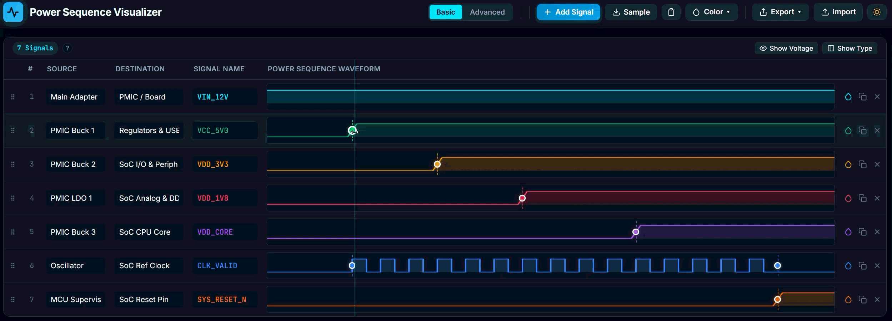

# ⚡ Power Sequence Visualizer & Drafter

> **A fast, intuitive, zero-dependency web tool for hardware engineers, power architects, and embedded system designers to draft, visualize, and document electronic power-up/down sequences.**

[-blue.svg)](#)
[](#)
[](#)
[](#)

---

## 💡 Why This Tool?

In modern embedded hardware (SoCs, FPGAs, GPUs, PMICs, and complex PCBs), defining strict power-up and power-down sequences is critical to prevent semiconductor latch-up, high inrush currents, and component damage. 

Historically, hardware engineers were forced to choose between:
- **Tedious manual drafting** in Visio, draw.io, or PowerPoint, which are painful to edit and align.
- **Code-based generators** which require writing raw JSON text without direct mouse interaction or continuous physical time scales.
- **Expensive desktop software** that requires paid licenses and lacks web portability.

**Power Sequence Visualizer** bridges this gap: it offers the **instant, drag-and-drop feel of a modern design tool** combined with **engineering rigor** (voltages, sources, destinations, gated clocks, and physical millisecond timing).

---

## ✨ Main Highlights

###  1. Rapid Power Sequence Mockup
- **Direct-Manipulation Edge Sliders**: Grab the circular dot marker (`●`) on any transition edge and drag it left or right. Waveforms track your cursor with zero lag.
<p align="center">
  
</p>
- **Real-Time Live Row Reordering**: Click and drag the `⋮⋮` grip on any row. The row elevates into a floating card, and the table dynamically reorders in real-time as you drag across rows.
- **Click-to-Position**: Click anywhere along a waveform track to immediately jump the transition edge to that point.
- **Double-Click Mode Toggle**: Double-click any waveform track to quickly cycle through waveform types without opening menus.
- **Preset Sample Sequence**: Load a realistic SoC power tree (Core, Memory, I/O, Oscillator, Reset) with one click to start drafting immediately.

###  2. Smart Magnetic Snapping
- **Cross-Rail Alignment**: When dragging a transition edge, it magnetically snaps to edges on rails above or below it with visual feedback (`🧲 Snapped to VDD_CORE`).
- **Timeline Grid Snapping**: Built-in 5% grid tick snapping for clean increments.
- **Shift Bypass**: Hold <kbd>Shift</kbd> while dragging for free-form, smooth sub-pixel placement.
- **Synchronized Vertical Crosshair**: A full-height vertical guide line follows your cursor across all signals for instant visual inspection of timing relationships.

###  3. Rich Waveform Library
- **Rising Sequence (`0 → 1`)**: Standard power rail turn-on with realistic slew transition.
- **Falling Sequence (`1 → 0`)**: Power-down rail discharge.
- **Pulse (`0 → 1 → 0`)**: Active-high pulse / strobe with independent start and end sliders.
- **Inverted Pulse (`1 → 0 → 1`)**: Active-low pulse / reset strobe with independent start and end sliders.
- **Clock (`50% Duty Cycle Square Wave`)**: Continuous high-frequency square wave with **Start & Stop gating sliders** (define exactly when reference oscillators start or halt).
- **Static Rails**: Continuous `HIGH only (1)` or `LOW only (0)`.

###  4. Modern, Clean UI & Visual Customization
- **Color Coding (7 Wire Colors)**: Choose from 7 distinct electronics schematic colors (Cyan, Emerald, Amber, Rose, Purple, Blue, Orange) per rail, or batch-apply with one click.
- **Dual Presentation Modes**:
  - **Basic Mode**: Clean, presentation-ready view that removes all numbers, timestamps, and rulers for clean conceptual overviews.
  - **Advanced Mode**: High-precision engineering mode displaying units (`ms`, `µs`, `ns`, `s`, `%`), total duration, timestamp labels, and crosshair badges.
- **Oscilloscope Dark & Clean Light Themes**: One-click toggle between CAD dark theme and crisp documentation light mode.
- **Compact Workspace**: Voltage and Waveform Type columns can be hidden to maximize screen real estate, fitting more waveforms on screen.
- **Resizable Columns**: Drag column header borders (`Source`, `Destination`, `Signal Name`, `Voltage`) to customize cell widths.

###  5. Publication-Ready Exports (Zero Clipping)
- **Standalone Complete PDF Export**: Generates and downloads a clean, unclipped `power_sequence_diagram.pdf` that dynamically fits the full table and timeline without browser print clipping.
- **Vector SVG Export**: Clean, scalable SVG for embedding in datasheets, Altium/Cadence schematic packs, or Confluence.
- **High-DPI PNG Export**: 2× retina raster image export.
- **Export Marker Removal**: All exported files automatically omit editor drag handles, yielding publication-ready timing diagrams.
- **CSV Data Export**: Tabular timing delays and rail metadata for Excel, Google Sheets, or Python automated test bench scripts.
- **JSON Project Save/Load**: Save complete project state to a `.json` file and restore it anytime.

###  6. Zero Dependencies & 100% Private
- **Zero build steps**, zero npm packages, zero external CDNs, and zero telemetry.
- Runs 100% client-side inside your browser—safe for proprietary schematic reviews and classified hardware projects.

---

##  Quick Shortcuts & Interaction Guide

| Action | How to Perform |
| :--- | :--- |
| **Adjust Timing** | Drag the **●** dot marker horizontally |
| **Bypass Snapping** | Hold <kbd>Shift</kbd> while dragging marker |
| **Reorder Rails** | Drag the **⋮⋮** grip handle up or down |
| **Cycle Waveform Type** | Double-click directly on the waveform track |
| **Reposition Edge** | Click anywhere along the waveform line |
| **Resize Column** | Drag the right border of any column header |
| **Change Rail Color** | Click the **💧** waterdrop icon on the row |
| **Batch Recoloring** | Click the **Color ▾** menu in the top toolbar |
| **Toggle Mode** | Click **Basic** or **Advanced** in the top bar |
| **Quick Help** | Hover over the **`?`** icon in the table sub-bar |

---

## 🚀 Getting Started

Simply clone or download this repository and open `index.html` in any web browser:

```bash
git clone the project
cd power-sequence-visualizer

# Windows
start index.html

# macOS
open index.html

# Linux
xdg-open index.html
```

Or just double-click `index.html` in your file explorer. No server or internet connection required!

---

## 🛠️ Project Structure

```text
├── index.html       # Clean semantic layout, toolbars, and table structure
├── style.css        # Responsive dark/light oscilloscope themes & animations
├── app.js           # Waveform engine, drag/snap physics, and multi-format exporters
└── README.md        # Documentation
```

---

## 📄 License

This project is licensed under the [MIT License](LICENSE) — free for personal, educational, and commercial hardware engineering workflows.
